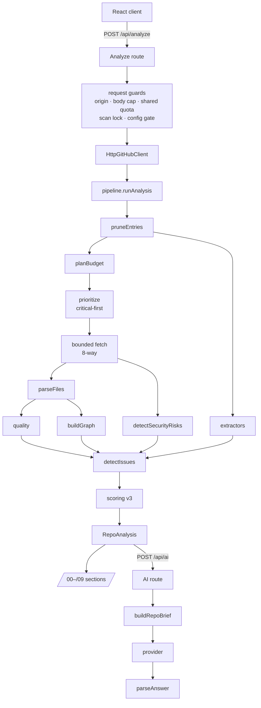

# Architecture — Codebase X-Ray

**Engine:** `xray.engine v3.0.0` · deterministic, network-agnostic pipeline over an injected GitHub client.

## System flow

## Modules

| Path | Responsibility |
|---|---|
| `src/lib/github/` | the only network module; URL parsing |
| `src/lib/analysis/pipeline.ts` | orchestration, budgets, coverage, assembly |
| `src/lib/analysis/budgets.ts` | tiers and absolute ceilings |
| `src/lib/analysis/critical.ts` | path-based critical categories + coverage warnings |
| `src/lib/analysis/capabilities.ts` | language depth matrix (derived from registry) |
| `src/lib/analysis/parsers/` | registry + TS AST / Python / generic parsers |
| `src/lib/analysis/tree-utils.ts` | pruning, classification, deterministic priority |
| `src/lib/analysis/extractors/` | stats, dependencies, testing, docs, security, architecture |
| `src/lib/analysis/quality.ts` | measured function/duplicate metrics |
| `src/lib/analysis/security-rules.ts` | redacted risk patterns |
| `src/lib/analysis/graph.ts` | nodes, aliases, workspaces, unresolved imports |
| `src/lib/analysis/issues/detectors.ts` | evidence-complete findings |
| `src/lib/analysis/scoring/` | versioned weights, damping, confidence |
| `src/lib/ai/` | optional assistant (config, context, prompts, provider, validate, service) |
| `benchmarks/` | labelled corpus + runner; writes reproducible artifacts |
| `src/app/api/` | analyze and ai route handlers |

## Key invariants

1. `runAnalysis` never imports the HTTP client; every test injects a fake.
2. Budgets are hard caps; exceeding one produces `partial` + a quantified warning.
3. Only the TypeScript parser sets `ast: true`.
4. Secret values never enter findings, responses or AI context.
5. The AI layer cannot measure, scan or modify anything.
6. Scores are comparable only within `scoringVersion`.
7. Production analysis requires a shared quota store and a GitHub token; both fail closed.
8. The quota identity is a hashed platform-provided IP header, never a client-supplied claim.

## Data contract

`RepoAnalysis { repo, analysis, score, structure, graph, issues, insights, system }` — see `src/lib/types/analysis.ts`. Coverage carries `inspectedPct`, `skippedForBudget`, `unsupportedSourceFiles`, `critical[]` and `capabilities`.
